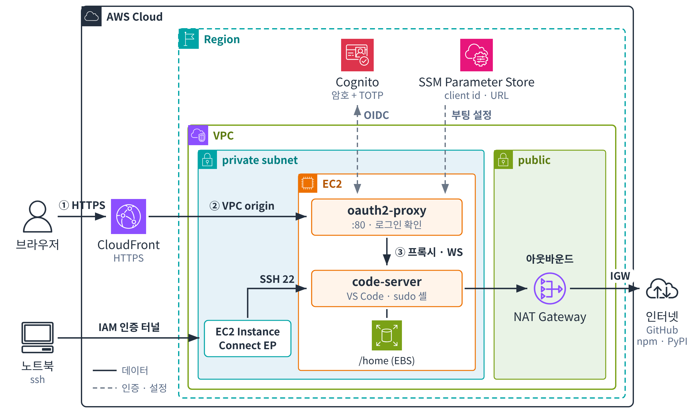

<h1 align="center">code2</h1>

<p align="center"><b>내 AWS 계정에 만드는 브라우저용 개인 VS Code 개발 서버</b><br>
CloudFront → private EC2(Graviton) → code-server, Cognito 로그인(기본 MFA)</p>

---

## 한눈에 보기

- CloudFormation 스택 하나로 **전용 VPC, private EC2, CloudFront, Cognito 로그인**이 모두 만들어집니다. 미리 준비할 네트워크나 리소스는 없습니다. 이미 있는 VPC에 넣을 수도 있습니다.
- 배포가 끝나면 받은 URL에 접속해 Cognito로 로그인(암호 + TOTP, `CODE2_MFA=off`면 암호만)합니다. 로그인하면 바로 VS Code가 열립니다.
- 서버는 공인 IP가 없는 private 서브넷의 EC2(기본 `t4g.medium`, 2 vCPU / 4 GiB, 다른 Graviton·x86 Nitro 타입도 가능)입니다. 외부에서 들어오는 길은 **CloudFront(HTTPS)** 와 **EC2 Instance Connect Endpoint(SSH, IAM 인증)** 두 가지뿐입니다.
- 작업 공간(`/home`)은 별도 EBS 볼륨에 있어서 인스턴스를 바꿔도 남습니다. 매일 스냅샷으로 백업합니다.
- 도메인은 없어도 됩니다. 기본으로 CloudFront 주소(`https://dxxxx.cloudfront.net`)를 쓰고, Route 53 도메인이 있으면 `code.example.com` 같은 주소로 붙일 수 있습니다.

## 빠른 시작

필요한 것: AWS 계정, AWS CLI v2, `jq`, 관리자 수준 자격 증명(VPC, EC2, IAM, CloudFront, Cognito, SSM, CloudWatch, DLM을 만듭니다). SSH와 Session Manager를 쓰려면 [Session Manager plugin](https://docs.aws.amazon.com/systems-manager/latest/userguide/session-manager-working-with-install-plugin.html)도 설치합니다.

```bash
git clone https://github.com/conft2k/app-code2.git && cd app-code2

export AWS_REGION=ap-northeast-2              # 원하는 리전
export CODE2_ADMIN_EMAIL=you@example.com      # 임시 암호를 받을 메일
# export CODE2_ADMIN_USER=alice               # 로그인 이름 (기본 admin)
# export CODE2_DOMAIN=code.example.com        # 선택: 내 도메인 (아래 "내 도메인 쓰기")
# export CODE2_MFA=off                        # 선택: TOTP 없이 암호만 (기본 on)
# export CODE2_ALARM_EMAIL=you@example.com    # 선택: 장애 알림 메일 (아래 "모니터링")

infra/deploy.sh stack plan     # 사전 점검 후 변경 세트만 만들고 내용을 보여 줍니다
infra/deploy.sh stack apply    # 실행 (약 15–20분, 서버 설정이 끝날 때까지 기다립니다)
infra/deploy.sh status         # URL 확인, 서비스가 active active 이면 준비 완료
```

1. `CODE2_ADMIN_EMAIL`로 임시 암호가 옵니다(7일 유효).
2. `status`에 나온 URL에 접속해 임시 암호로 로그인합니다.
3. 새 암호(기본 12자 이상, `CODE2_PASSWORD_MIN_LENGTH`)를 정하고 인증 앱(Google Authenticator, 1Password 등)에 TOTP를 등록합니다(`CODE2_MFA=off`면 암호만 정합니다).

`stack apply`는 인스턴스가 code-server와 oauth2-proxy를 다 띄웠다고 알려 올 때까지 기다립니다. 설정이 실패하면(다운로드 실패, Cognito 설정 오류 등) 스택이 롤백되고, 실패한 줄과 로그 끝부분이 `BootWait` 이벤트 사유에 나옵니다. 원인을 인스턴스에서 직접 보려면 `CODE2_KEEP_ON_FAILURE=1 infra/deploy.sh stack apply`로 롤백 없이 실행합니다.

`plan`은 변경 세트를 만들기 전에 스택 이름 규칙, Nitro 인스턴스 타입인지, 그 타입을 제공하는 AZ, VPC·EIP·EICE 할당량을 확인합니다.

### 내 도메인 쓰기 (선택)

1. Route 53에 공개 호스티드 존(예: `example.com`)이 있어야 합니다.
2. **us-east-1**에 `*.example.com` 또는 `code.example.com`을 포함하는 발급 완료된 ACM 인증서가 있어야 합니다(CloudFront용). SAN에 들어 있어도 되고, RSA·ECDSA 모두 찾습니다.
3. 첫 `stack plan` 전에 `CODE2_DOMAIN=code.example.com`을 지정합니다. 스크립트가 도메인이 속한 공개 호스티드 존과 인증서를 찾아 넣고, A/AAAA 레코드를 만듭니다. 자동으로 못 찾으면 `CODE2_ZONE`(존 이름) 또는 `CODE2_ZONE_ID`, `CODE2_CERT_ARN`으로 지정합니다.

도메인은 처음 만들 때 정합니다. 나중에 바꾸면 Cognito 콜백 주소와 인스턴스 설정이 어긋나므로, 스택을 새로 만드는 편이 안전합니다.

Cognito 로그인 페이지도 내 도메인으로 바꿀 수 있습니다(기본은 `<스택>-<계정>.auth.<리전>.amazoncognito.com`). `CODE2_AUTH_DOMAIN=auth.code.example.com`처럼 `CODE2_DOMAIN` 아래 이름을 지정하면, 스크립트가 그 이름을 덮는 us-east-1 인증서(`CODE2_AUTH_CERT_ARN`로 지정 가능)를 찾아 넣고 A/AAAA 레코드를 만듭니다. Cognito는 상위 이름(`code.example.com`)의 A 레코드가 있어야 커스텀 도메인을 만들 수 있어서, 사이트 레코드가 생긴 뒤에 만들어집니다. 생성 후에도 켜고 끌 수 있습니다(도메인이 교체되고 인스턴스 재시작 없이 oauth2-proxy만 다시 시작되며, 그동안 로그인이 잠시 안 될 수 있습니다).

### 이미 있는 VPC 쓰기 (선택)

새 VPC와 NAT Gateway 대신 기존 네트워크에 넣으려면, 첫 `stack plan` 전에 지정합니다.

```bash
export CODE2_VPC_ID=vpc-0123...           # 인터넷 게이트웨이가 붙어 있어야 합니다 (CloudFront VPC origin 요건)
export CODE2_SUBNET_ID=subnet-0123...     # private 서브넷, 0.0.0.0/0 → NAT 경로 필요
```

- 스크립트가 서브넷의 AZ, VPC CIDR, 인터넷 게이트웨이, NAT 경로를 확인합니다.
- 그 VPC에 EC2 Instance Connect Endpoint가 이미 있으면 그것을 씁니다(VPC당 하나). 스택이 그 엔드포인트의 보안 그룹에 인스턴스로 나가는 22번 egress 규칙을 추가합니다(스택을 지우면 규칙도 지워집니다).
- 인스턴스의 `:80`은 CloudFront origin-facing 관리형 prefix list에서만 열리므로, 같은 VPC의 다른 워크로드는 닿을 수 없습니다.
- NAT Gateway와 공인 IPv4 요금(월 약 $46)이 들지 않습니다.

## 동작 아키텍처

### 전체 구성

<p align="center">
  
</p>

실선은 데이터가 지나는 경로이고, 점선은 인증·설정 같은 제어 경로입니다. 바깥에서 들어오는 길은 CloudFront와 EC2 Instance Connect Endpoint 두 곳뿐이고, 인스턴스에는 공인 IP가 없습니다. dnf 저장소 같은 S3 트래픽은 그림에 없는 S3 게이트웨이 엔드포인트로 NAT를 거치지 않고 나갑니다. 그림에 없는 CloudWatch(로그·지표·알람)와 Data Lifecycle Manager(일일 스냅샷)도 함께 만들어집니다. 설정 스크립트를 두는 S3 버킷 `code2-setup-<계정>-<리전>`은 스택 밖에서 `deploy.sh`가 만듭니다.

### 브라우저 접속 흐름

1. 브라우저가 code2 URL로 접속합니다. CloudFront가 TLS를 끝내고, 캐시 없이 모든 헤더와 쿠키를 그대로 실어 VPC origin으로 인스턴스의 `:80`에 전달합니다.
2. **oauth2-proxy**가 세션 쿠키(`_code2`)를 확인합니다. 쿠키가 없으면 Cognito 관리형 로그인 페이지로 보냅니다. Authorization code + PKCE(S256) 방식입니다.
3. 사용자가 암호와 TOTP(`Mfa=on`일 때)로 로그인하면 Cognito가 `/oauth2/callback`으로 되돌려 보냅니다. oauth2-proxy는 코드를 토큰으로 바꾸고 ID 토큰을 검증한 뒤 세션 쿠키를 발급합니다.
4. 이후 요청은 oauth2-proxy가 `127.0.0.1:8080`의 **code-server**로 프록시합니다. 에디터와 터미널이 쓰는 WebSocket도 같은 경로로 지나갑니다. code-server는 `--auth none`이라 따로 로그인을 묻지 않고, 루프백에만 열려 있어서 oauth2-proxy를 거치지 않고는 닿을 수 없습니다.
   `/admin`과 그 아래 요청은 같은 세션으로 `127.0.0.1:7681`의 **ttyd**(브라우저 터미널)로 갑니다. ttyd도 code-server처럼 루프백에만 열려 있어서 oauth2-proxy를 거쳐야만 닿습니다.
5. 세션은 최대 `SessionHours`(기본 12시간) 유지됩니다. oauth2-proxy가 30분마다 refresh 토큰으로 갱신하고, refresh 토큰이 만료되면 다시 로그인해야 합니다.
6. 로그아웃은 `status`에 나오는 **logout** 주소로 합니다. oauth2-proxy 세션과 Cognito 세션을 모두 끝내고 로그인 화면으로 돌아옵니다.

### 부팅과 설정

- CloudFront 배포는 인스턴스를 가리키므로, 인스턴스가 먼저 만들어지고 CloudFront 주소와 Cognito 클라이언트는 그 뒤에 정해집니다. 그래서 스택이 이 두 값을 SSM 파라미터 `/<스택 이름>/oauth2-proxy`에 써 두고, 인스턴스는 이 값이 나타날 때까지(최대 30분) 기다렸다가 oauth2-proxy를 설정합니다. code-server는 그 전에 먼저 켜집니다.
- `/home` 볼륨은 인스턴스가 부팅할 때 **직접** 붙입니다(인스턴스 역할은 이 볼륨을, 이 인스턴스 프로필로 시작한 인스턴스에만 붙일 수 있습니다). 덕분에 인스턴스가 교체되어도 새 인스턴스가 옛 인스턴스가 종료되기를 기다렸다가 볼륨을 이어받습니다.
- 처음 만들 때는 설정이 끝나면 인스턴스가 CloudFormation `BootWait`에 성공/실패를 알립니다.
- 설정 스크립트는 user data가 아니라 `infra/setup.sh`에 있습니다. user data는 S3(`code2-setup-<계정>-<리전>/<스택>/setup.sh`)에서 이 스크립트를 받아 실행하는 몇 줄짜리 부트스트랩이라 스택이 살아 있는 동안 바뀌지 않고, 그래서 설정을 바꿔도 인스턴스가 재시작되지 않습니다.
- 버전 같은 설정은 SSM 파라미터 `/<스택 이름>/setup`에 들어가고, 스크립트는 실행할 때마다 이 값을 읽습니다. `stack apply`는 `setup.sh`를 S3에 올리고 스택을 바꾼 뒤, 실행 중인 인스턴스에서 스크립트를 SSM으로 다시 실행합니다. `setup.sh`만 바꿨을 때는 `reconfigure`로 바로 적용합니다.
- 스크립트는 여러 번 실행해도 결과가 같게 짜여 있고 부팅할 때마다 다시 실행되므로, 교체되거나 재시작된 인스턴스에도 저장소의 설정이 그대로 들어갑니다. 바뀐 것이 있는 서비스만 재시작합니다. 손으로 고친 설정은 다음 실행 때 덮어쓰이므로, 바꿀 것은 `setup.sh`에 넣습니다.
- 설정 로그는 `/var/log/code2-setup.log`에 쌓이고, CloudWatch Logs `/code2/<스택 이름>`으로도 보냅니다(`infra/deploy.sh logs`). 비밀값은 로그에 남지 않습니다.

### SSH 접속 흐름

1. `aws ec2-instance-connect send-ssh-public-key`로 일회용 공개 키를 인스턴스에 넣습니다. 키는 60초 동안만 유효합니다.
2. `aws ec2-instance-connect open-tunnel`이 IAM 인증을 거쳐 같은 VPC의 EC2 Instance Connect Endpoint까지 터널을 엽니다.
3. 엔드포인트가 인스턴스의 22번 포트에 연결합니다. 엔드포인트 보안 그룹은 인스턴스의 22번으로 나가는 것만 허용합니다.

`infra/deploy.sh ssh`가 이 세 단계를 한 번에 처리합니다. 호스트 키는 인스턴스 ID별로 따로 기억하므로, 인스턴스가 교체되어도 호스트 키 불일치로 막히지 않습니다.

### 보안

| 영역 | 설정 |
|---|---|
| 인바운드 | 인스턴스 보안 그룹: `:80`은 CloudFront origin-facing 관리형 prefix list(`com.amazonaws.global.cloudfront.origin-facing`)에서만, `:22`는 EICE 보안 그룹에서만 허용합니다. VPC origin 요청은 ENI의 VPC 주소가 아니라 이 대역에서 들어옵니다. 공인 IP는 없습니다 |
| 로그인 | User Pool은 관리자만 계정을 만들 수 있고, 기본으로 **TOTP MFA가 필수**입니다(`CODE2_MFA=off`로 끌 수 있지만, sudo 셸이 걸린 로그인이라 권하지 않습니다). 암호는 기본 최소 12자(`CODE2_PASSWORD_MIN_LENGTH`, 8–99)이며 소문자와 숫자를 반드시 넣어야 합니다. 삭제 보호를 켜 두었고 스택을 지워도 남습니다(`Retain`) |
| 비밀값 | Cognito 클라이언트 시크릿은 부팅할 때 인스턴스 역할(`cognito-idp:DescribeUserPoolClient`, 이 User Pool로 한정)로 직접 읽습니다. 쿠키 서명 키는 인스턴스에서 한 번 생성해 재부팅해도 유지합니다. 둘 다 `/etc/oauth2-proxy/secrets.env`(600)에만 있고, 템플릿·파라미터·저장소·로그에는 없습니다 |
| 인스턴스 역할 | SSM 관리, CloudWatch 에이전트, 자기 Cognito 클라이언트 읽기, 자기 `/home` 볼륨 붙이기(이 볼륨 + 이 인스턴스 프로필로 한정) |
| 인스턴스 | IMDSv2 필수(hop limit 1), EBS 암호화, oauth2-proxy는 전용 시스템 사용자로 실행하고 `:80` 바인딩 권한만 가집니다(`ProtectSystem=strict`) |
| 패치 | 기본으로 dnf-automatic이 매일 **보안 업데이트**를 적용합니다(최신 AL2023 저장소를 따라감, 자동 재부팅은 하지 않음). 커널 업데이트는 재부팅해야 적용됩니다 |
| 소프트웨어 | code-server, oauth2-proxy, ttyd 버전을 파라미터로 고정합니다. 다운로드는 재시도합니다. oauth2-proxy와 ttyd 파일은 릴리스의 sha256 파일로 무결성을 확인합니다(같은 출처라 위변조 방지는 아닙니다) |

> 로그인하면 `ec2-user` 권한의 셸과 **sudo**를 쓸 수 있습니다. 인스턴스 역할 자격 증명(위 표)에도 닿을 수 있습니다. 계정은 꼭 필요한 사람에게만 만들어 주세요.

## 개발 환경

### 서버

| 항목 | 값 |
|---|---|
| 인스턴스 | 기본 `t4g.medium` (Graviton2, 2 vCPU, 4 GiB, 버스터블 standard: 평소 vCPU당 20%, 크레딧이 남아 있으면 100%). 4 GiB Graviton 중 가장 저렴합니다. 메모리가 모자라면 `t4g.large`(8 GiB), 그 밖에 `m7g`, `m8g`, `t3`, `m7i` 등 Nitro 타입이면 됩니다(`/home`을 NVMe ID로 찾으므로 `t2`, `m4` 같은 Xen 타입은 `plan`이 거부합니다) |
| OS | Amazon Linux 2023 (arm64 또는 x86_64, 인스턴스 타입에 맞춤) |
| 사용자 | `ec2-user` (sudo 가능), code-server와 SSH 모두 같은 사용자 |
| 디스크 | `/` 30 GiB gp3, `/home` 50 GiB gp3 (XFS, 레이블 `code2-home`). 둘 다 파라미터로 바꿀 수 있습니다 |
| code-server | 4.139.1, `127.0.0.1:8080`, 텔레메트리와 업데이트 확인 끔 |
| ttyd | 1.7.7, `127.0.0.1:7681`, `<URL>/admin/`. `ec2-user`의 tmux 세션 `admin`을 엽니다 |
| 확장 마켓플레이스 | Open VSX (code-server 기본값) |

### 기본 설치 도구

`git`, `python3` (+ `pip`), `gcc`, `make`, `tmux`, `jq`, AWS CLI v2. **Node.js와 Docker는 설치되어 있지 않습니다.**

필요한 도구는 직접 설치합니다. 인스턴스를 교체하면 `/` 아래는 새로 만들어지므로, 오래 쓸 도구는 `/home` 아래에 설치하는 편이 안전합니다.

| 설치 위치 | 예 | 인스턴스 교체 시 |
|---|---|---|
| `/home/ec2-user` (사용자 단위) | `nvm`/`fnm`으로 Node, `uv`/`pipx`로 Python 도구, `~/.local/bin`, 저장소, VS Code 설정과 확장 | **유지** |
| `/` (시스템 단위) | `sudo dnf install nodejs20 python3.12 docker` | 다시 설치해야 함 |

### 쓰는 방법

| 방법 | 방법 |
|---|---|
| 브라우저 | `infra/deploy.sh status`의 URL에서 로그인. 터미널은 `` Ctrl+` ``. 로그아웃은 `status`의 logout 주소 |
| 브라우저 터미널 | `<URL>/admin/`에서 에디터 없이 터미널만 엽니다(로그인은 code-server와 같은 세션). tmux 세션 `admin`에 붙으므로 창을 닫았다 열어도 작업이 이어지고, SSH에서는 `tmux attach -t admin`으로 같은 화면을 봅니다 |
| 개발 서버 미리 보기 | 인스턴스에서 띄운 웹 서버는 `<URL>/proxy/<포트>/` 로 엽니다(로그인 필요). 경로 접두사를 그대로 넘기려면 `/absproxy/<포트>/` 를 씁니다 |
| SSH | `infra/deploy.sh ssh` |
| VS Code Remote-SSH | `infra/deploy.sh ssh-config`가 출력하는 블록을 `~/.ssh/config`에 붙이고, 접속 전에 같은 출력에 있는 `send-ssh-public-key` 명령으로 키를 넣습니다 |
| Session Manager | `infra/deploy.sh shell` (SSH 키 없이 `ssm-user` 셸, sudo 가능) |

GitHub에는 인스턴스에서 `ssh-keygen -t ed25519`로 키를 만든 뒤 계정에 등록해 접근합니다. 키는 `/home`에 있어서 인스턴스를 교체해도 남습니다.

## 운영

저장소 루트에서 실행합니다. 설정은 환경 변수로 줍니다. **업데이트할 때 지정하지 않은 값은 현재 값을 그대로 씁니다.**

| 명령 | 하는 일 |
|---|---|
| `infra/deploy.sh stack plan` | 변경 세트를 만들고 변경 내용만 보여 줍니다. 아무것도 바꾸지 않습니다 |
| `infra/deploy.sh stack apply` | `setup.sh`를 S3에 올리고 가장 최근 변경 세트를 실행한 뒤, 인스턴스에서 `setup.sh`를 다시 실행합니다. plan 이후 템플릿이나 `setup.sh`가 바뀌었으면 실행하지 않습니다 |
| `infra/deploy.sh status` | URL, 로그아웃 주소, 인스턴스 상태, 서비스 상태, `/home` 사용량, 설치된 버전을 보여 줍니다 |
| `infra/deploy.sh logs [-f] [기간]` | CloudWatch Logs의 설정 로그를 봅니다(기본 최근 1시간, 예: `logs 1d`, `logs -f`) |
| `infra/deploy.sh reconfigure` | `setup.sh`를 S3에 올리고 재시작 없이 인스턴스에서 실행합니다(스택 변경 없이 `setup.sh`만 바꿨을 때) |
| `infra/deploy.sh ssh [명령]` | EICE를 거쳐 `ec2-user`로 SSH 접속합니다 |
| `infra/deploy.sh ssh-config` | `~/.ssh/config`용 블록을 출력합니다 |
| `infra/deploy.sh shell` | Session Manager 셸을 엽니다 |
| `infra/deploy.sh stop` / `start` | 인스턴스를 중지하거나 시작합니다. 중지하면 사이트는 502를 반환하고, NAT Gateway 요금은 계속 나갑니다 |
| `infra/deploy.sh destroy` | 스택 이름을 한 번 더 입력받고 스택을 지운 뒤, 남는 User Pool과 스냅샷을 알려 줍니다 |

### 설정 변수

| 변수 | 기본값 | 언제 바꿀 수 있나 | 설명 |
|---|---|---|---|
| `CODE2_ADMIN_EMAIL` | (필수, 첫 배포) | 언제든 | 임시 암호를 받을 메일 |
| `CODE2_ADMIN_USER` | `admin` | 언제든 | 로그인 이름. 바꾸면 사용자를 새로 만듭니다(아래 "계정") |
| `CODE2_STACK` | `code2` | – | 스택 이름(소문자·숫자·하이픈, 50자 이하, `aws`/`amazon`/`cognito` 포함 불가: Cognito 도메인 접두사로 쓰입니다). 이름을 달리하면 한 계정에 여러 대를 만들 수 있습니다 |
| `CODE2_ACCOUNT` | 없음 | – | 지정하면 다른 계정의 자격 증명으로는 실행하지 않습니다 |
| `AWS_REGION` | `AWS_DEFAULT_REGION` → 프로필 리전 → `ap-northeast-2` | – | 배포 리전 |
| `CODE2_INSTANCE_TYPE` | `t4g.medium` | 언제든 | 같은 아키텍처면 중지 후 시작, 아키텍처가 다르면 인스턴스 교체 |
| `CODE2_DATA_SIZE` | `50` | 늘리기만 | `/home` GiB. 늘리면 다음 설정 실행 때 파일시스템도 늘립니다 |
| `CODE2_ROOT_SIZE` | `30` | 언제든 | `/` GiB. 바꾸면 인스턴스 교체 |
| `CODE2_CODE_SERVER_VERSION` / `CODE2_OAUTH2_PROXY_VERSION` | `4.139.1` / `7.15.5` | 언제든 | 재시작 없이 새 버전을 설치하고 그 서비스만 재시작합니다 |
| `CODE2_SESSION_HOURS` | `12` | 언제든 | 로그인 유지 시간(1–168) |
| `CODE2_MFA` | `on` | 언제든 | `on`: 첫 로그인 때 TOTP를 등록하고 매번 코드를 입력합니다. `off`: 암호만. 나중에 `on`으로 바꾸면 사용자는 다음 로그인 때 TOTP를 등록합니다. Cognito의 OPTIONAL은 관리형 로그인이 TOTP 등록 화면을 띄우지 않아 넣지 않았습니다 |
| `CODE2_AUTO_UPDATES` | `true` | 언제든 | 매일 보안 업데이트 |
| `CODE2_IDLE_STOP_HOURS` | `0` (끔) | 언제든 | 유휴 상태가 이 시간만큼 이어지면 인스턴스 중지(아래 "유휴 중지") |
| `CODE2_BACKUP_COUNT` | `7` | 언제든 | 보관할 일일 `/home` 스냅샷 수. `0`이면 백업 끔 |
| `CODE2_ALARM_EMAIL` | 없음 | 언제든 | CloudWatch 알람 메일. 빈 값으로 지정하면 알람을 지웁니다 |
| `CODE2_PRICE_CLASS` | `PriceClass_200` | 언제든 | CloudFront 가격 등급 |
| `CODE2_UPDATE_AMI=1` | – | 업데이트 때 | 최신 AL2023 AMI로 인스턴스를 교체합니다 |
| `CODE2_KEEP_ON_FAILURE=1` | – | apply 때 | 실패해도 롤백하지 않습니다(원인 조사용) |
| `CODE2_SSH_KEY` | `~/.ssh/id_ed25519` | – | SSH에 쓸 키(없으면 만듭니다) |
| `CODE2_PASSWORD_MIN_LENGTH` | `12` | 언제든 | 최소 암호 길이(8–99). 이미 정한 암호에는 적용되지 않습니다 |
| `CODE2_AUTH_DOMAIN`, `CODE2_AUTH_CERT_ARN` | 없음 | 언제든 | Cognito 로그인 페이지 도메인(위 "내 도메인 쓰기"). 빈 값으로 지정하면 기본 도메인으로 돌아갑니다 |
| `CODE2_DOMAIN`, `CODE2_ZONE`, `CODE2_ZONE_ID`, `CODE2_CERT_ARN` | 없음 | 생성 때만 | 내 도메인 |
| `CODE2_AZ` | 인스턴스 타입을 제공하는 첫 AZ | 생성 때만 | 인스턴스와 `/home`의 AZ |
| `CODE2_VPC_ID`, `CODE2_SUBNET_ID` | 없음 | 생성 때만 | 기존 VPC 사용 |
| `CODE2_RESTORE_SNAPSHOT` | 없음 | 생성 때만 | 이 스냅샷으로 `/home`을 만듭니다(아래 "백업과 복구") |

예: 인스턴스를 키우고 code-server를 올리기

```bash
CODE2_INSTANCE_TYPE=t4g.large CODE2_CODE_SERVER_VERSION=4.140.0 infra/deploy.sh stack plan
infra/deploy.sh stack apply      # 인스턴스 유형이 바뀌어 중지 후 시작되고, 부팅 때 새 버전을 설치합니다
infra/deploy.sh status           # 설치된 버전 확인
```

### 인스턴스 교체

AMI, 루트 볼륨 크기, 아키텍처가 바뀌면 인스턴스가 교체됩니다. 같은 아키텍처 안에서 인스턴스 유형만 바뀌면 교체 없이 중지 후 시작하고, 버전·설정은 인스턴스를 건드리지 않습니다. user data는 스택을 이 구조로 옮길 때 한 번만 바뀌며, 이때도 교체 없이 중지 후 시작합니다(CloudFormation 변경 세트는 `Conditional`로 표시하지만, `plan`은 교체로 보지 않습니다).

1. CloudFormation이 새 인스턴스를 만듭니다. 새 인스턴스는 `/home` 볼륨이 풀릴 때까지 기다립니다.
2. CloudFront VPC origin은 배포에 연결된 채로 다른 인스턴스를 가리키도록 바꿀 수 없습니다. 그래서 `plan`이 인스턴스 재생성을 감지하면 VPC origin 슬롯(`OriginSlot`, a↔b)을 바꿉니다. 새 인스턴스용 VPC origin을 만들고 배포를 그쪽으로 돌립니다.
3. 정리 단계에서 옛 VPC origin과 옛 인스턴스를 지웁니다. 옛 인스턴스가 종료되면 새 인스턴스가 볼륨을 붙이고 서비스를 띄웁니다.

배포가 넘어간 뒤 옛 인스턴스가 종료될 때까지(실측 약 9분) 사이트는 504를 반환합니다. 업데이트가 실패해 롤백되면 옛 인스턴스와 볼륨은 그대로입니다. 교체 후에는 다시 로그인해야 하고, `ssh-config` 블록도 다시 만들어야 합니다.

```bash
CODE2_UPDATE_AMI=1 infra/deploy.sh stack plan   # 최신 AL2023으로 교체
```

### 백업과 복구

- Data Lifecycle Manager가 매일 03:00 KST에 `/home` 스냅샷을 만들고 최근 `CODE2_BACKUP_COUNT`개(기본 7개)를 남깁니다.
- 스택을 지우면 마지막 스냅샷이 하나 더 남습니다. 일일 스냅샷도 정책이 지워진 뒤 그대로 남으니, 필요 없으면 직접 지웁니다(`destroy`가 목록을 보여 줍니다).
- 스냅샷에서 다시 만들기:

  ```bash
  CODE2_RESTORE_SNAPSHOT=snap-0123... CODE2_ADMIN_EMAIL=you@example.com infra/deploy.sh stack plan
  ```

  `/home` 크기는 스냅샷 크기 이상이어야 합니다(`CODE2_DATA_SIZE`).
- 파일 하나를 되살리려면 스냅샷으로 볼륨을 만들어 인스턴스에 잠시 붙이고 마운트해서 복사합니다.

### 모니터링

- 항상 켜지는 것
  - CloudWatch 에이전트가 설정 로그(`/code2/<스택 이름>`, 30일 보관)를 보냅니다.
  - `/`·`/home` 디스크 사용률과 메모리 사용률을 5분마다 지표로 보냅니다.
- `CODE2_ALARM_EMAIL`을 지정하면 SNS 토픽과 알람이 만들어집니다. 처음에 오는 **구독 확인 메일**을 승인해야 알림을 받습니다.
  - EC2 상태 검사 실패 (복구될 때도 알림)
  - `/home` 또는 `/` 사용률 85% 이상
  - 부팅 설정 실패
- 비용 알림은 템플릿에 넣지 않았습니다. [AWS Budgets](https://console.aws.amazon.com/billing/home#/budgets)에서 월 예산 알림을 만들어 두기를 권합니다. `project=code2` 태그를 비용 할당 태그로 활성화하면 code2만 따로 볼 수 있습니다.

### 유휴 중지

`CODE2_IDLE_STOP_HOURS=4`처럼 지정하면, 인스턴스가 5분마다 활동을 확인합니다. 활동이 그 시간 동안 없으면 스스로 중지합니다.

- **활동으로 보는 것:** 브라우저 연결(code2 탭이 열려 있으면 활동), SSH 연결, Session Manager 세션, 부하(load average 0.5 초과)
- 탭을 닫고 `tmux`에서 오래 걸리는 작업을 돌리는 경우, 부하가 낮으면 중지될 수 있습니다.
- 다시 쓸 때는 `infra/deploy.sh start`를 실행합니다. 중지해도 NAT Gateway·IPv4·EBS 요금은 계속 나갑니다.

### 계정

```bash
aws cognito-idp admin-create-user --user-pool-id <UserPoolId> --username <이름> \
  --user-attributes Name=email,Value=<메일> Name=email_verified,Value=true
```

모든 계정은 같은 서버의 같은 `ec2-user`로 들어갑니다. 사람마다 따로 환경이 필요하면 `CODE2_STACK`을 달리해 스택을 하나씩 만듭니다.

암호를 잊었으면 로그인 페이지의 **Forgot your password?**에서 등록된 메일로 코드를 받아 재설정합니다. 첫 로그인 전(`FORCE_CHANGE_PASSWORD`)에는 재설정이 안 되므로, 초대 메일을 다시 보냅니다(새 임시 암호가 발급되고 이전 것은 무효가 됩니다).

```bash
aws cognito-idp admin-create-user --user-pool-id <UserPoolId> --username <이름> --message-action RESEND
```

메일은 Cognito 기본 발신자(`no-reply@verificationemail.com`)로 오며 스팸함으로 갈 수 있습니다. 하루 발송 한도는 50통입니다.

`CODE2_ADMIN_USER`를 바꾸고 `stack plan`/`apply`를 하면, Cognito는 사용자 이름을 바꿀 수 없으므로 사용자를 새로 만들고(임시 암호 재발송, TOTP 재등록) 이전 사용자는 삭제합니다. 업데이트할 때 `CODE2_ADMIN_USER`를 지정하지 않으면 현재 이름을 그대로 씁니다.

### 인스턴스에서 직접 확인

```bash
systemctl status code-server oauth2-proxy ttyd
journalctl -u oauth2-proxy -n 50        # 로그인 / 콜백 오류
journalctl -u code-server -n 50
sudo tail -n 50 /var/log/code2-setup.log # 부팅 설정 기록 (매 부팅)
```

### 문제 해결

| 증상 | 원인과 조치 |
|---|---|
| `stack apply`가 `BootWait` 실패로 롤백 | 이벤트 사유에 실패한 줄과 로그 끝부분이 있습니다. `ROLLBACK_COMPLETE` 스택은 고칠 수 없으므로 `destroy` 후 다시 `plan`합니다. 원인을 직접 보려면 `CODE2_KEEP_ON_FAILURE=1`로 apply합니다 |
| `plan`이 "busy" 또는 `UPDATE_ROLLBACK_FAILED`로 멈춤 | 진행 중인 작업이 끝나기를 기다리거나, 안내된 `continue-update-rollback`을 실행합니다 |
| 처음 몇 분 또는 인스턴스 교체 중 502 | CloudFront 배포가 끝나기 전이거나, 새 인스턴스가 볼륨을 기다리는 중입니다. `logs -f`로 진행을 봅니다 |
| 업데이트 뒤 설정이 반영되지 않음 | `apply`가 끝에 경고를 냈다면 인스턴스가 아직 Systems Manager에 연결되지 않은 경우입니다. 이때는 부팅 때 스크립트가 실행되니 `logs`로 확인하고, 실행되지 않았으면 `reconfigure`를 실행합니다. 부팅 중인 인스턴스에서는 `apply`의 실행이 부팅 실행이 끝날 때까지 기다렸다가 한 번 더 돕니다 |
| `destroy`가 VPC 삭제에서 실패 | CloudFront가 만든 `CloudFront-VPCOrigins-Service-SG`가 늦게 지워지는 경우입니다. 잠시 뒤 `destroy`를 다시 실행합니다 |

### 주의

- `InstanceType`을 같은 아키텍처 안에서 바꾸면 중지 후 시작으로 적용되고, 인스턴스는 교체되지 않습니다.
- `/home` 볼륨은 줄일 수 없습니다. AZ, 네트워크, 도메인, 복구 스냅샷은 처음 만들 때 정하며, 바꾸려면 스택을 새로 만듭니다(스냅샷으로 `/home`을 옮길 수 있습니다).
- 리전에 CloudFront VPC origin을 지원하지 않는 AZ가 있을 수 있습니다. 생성이 VPC origin에서 실패하면 `CODE2_AZ`로 다른 AZ를 지정합니다.
- EC2 Instance Connect Endpoint는 계정·리전마다 개수 제한(기본 5개)이 있고, VPC당 하나입니다.
- 버스터블 크레딧이 떨어지면 CPU가 vCPU당 20%(`t4g.large`는 30%)로 제한됩니다(standard 모드라 추가 요금은 없음). 빌드가 자주 느리면 `m7g.large`로, 메모리가 모자라면(확장을 많이 쓰거나 빌드가 크면 4 GiB로는 빠듯합니다) `t4g.large`로 바꾸는 것을 검토합니다.
- 상용 AWS 파티션(`aws`)에서만 동작합니다(CloudFront VPC origin).

### 이전 버전으로 만든 스택 옮기기

이 버전 이전의 템플릿은 `/home`을 `AWS::EC2::VolumeAttachment` 리소스로 붙였습니다. 이 리소스를 그냥 빼면 CloudFormation이 마운트된 볼륨을 떼어 내므로, `stack plan`이 이를 감지해 두 단계로 진행합니다.

1. `stack plan` → `stack apply`: 지금 배포된 템플릿에 볼륨 연결 `Retain`만 더합니다(리소스 변경 없음).
2. `stack plan` → `stack apply`: 현재 템플릿으로 옮깁니다. 볼륨 연결은 스택에서만 빠지고 실제로는 붙어 있습니다. user data가 바뀌어 인스턴스가 한 번 중지 후 시작됩니다.
2단계의 `apply`가 끝에서 새 설정(부팅 시 재실행, CloudWatch 에이전트, 자동 보안 업데이트 등)을 인스턴스에 적용합니다. 경고가 나왔을 때만 `infra/deploy.sh reconfigure`를 한 번 실행합니다.

기존 스택은 `BootWait` 없이(`WaitForBoot=false`) 옮겨집니다.

### 삭제

```bash
infra/deploy.sh destroy
```

- `/home` 볼륨은 스냅샷으로 남습니다. 일일 백업 스냅샷도 남습니다. 필요 없으면 EC2 콘솔에서 지웁니다.
- User Pool은 남습니다(`Retain`, 삭제 보호). `destroy`가 지우는 명령을 알려 줍니다.

## 저장소 구성

```
code2/
├── README.md
├── .github/workflows/lint.yml   push·PR마다 infra/lint.sh 실행
├── docs/
│   ├── architecture.png         README 구성도
│   └── architecture.svg         구성도 원본 (아이콘 포함, 브라우저·Inkscape·draw.io에서 편집)
└── infra/
    ├── code2.yaml               CloudFormation: VPC·NAT·EICE(또는 기존 VPC), Cognito, EC2·EBS, CloudFront VPC origin,
    │                            CloudWatch 로그·알람, DLM 백업, (선택) Route 53
    ├── setup.sh                 인스턴스 설정 스크립트: /home, code-server, ttyd, oauth2-proxy, CloudWatch, 업데이트, 유휴 중지
    ├── deploy.sh                plan/apply(사전 점검·이관 포함), status, logs, reconfigure, ssh, shell, stop/start, destroy
    └── lint.sh                  cfn-lint, shellcheck (deploy.sh, setup.sh, user data), 템플릿 크기, 개인 정보 검사
```

바꾼 뒤에는 `infra/lint.sh`로 검사합니다(`pip install cfn-lint`, `shellcheck` 필요). 공개 저장소라서 실제 계정 ID, 리소스 ID, 이메일, 도메인이 들어가면 실패합니다. 예시는 `example.com`과 `vpc-0123...` 같은 자리 표시자를 씁니다.

## 예상 비용 (서울, 월, 대략)

| 항목 | 금액 |
|---|---|
| EC2 t4g.medium (24시간 상시, `t4g.large`면 약 $61) | 약 $30 |
| NAT Gateway (시간 요금, 데이터 $0.059/GB 별도) | 약 $43 |
| 공인 IPv4 (NAT EIP) | 약 $3.6 |
| EBS gp3 30 + 50 GiB | 약 $7 |
| `/home` 스냅샷 7개 (변경분만 저장) | 약 $1–3 |
| CloudWatch 지표 3개, 로그, 알람 (알람은 지정 시) | 약 $1–2 |
| CloudFront, Cognito(Essentials 무료 구간), EICE, Route 53 | 약 $1 미만 |
| **합계** | **약 $87–90** |

- 인스턴스를 중지하면 EC2 요금(약 $30)은 나가지 않지만, NAT Gateway·IPv4·EBS 요금은 계속 나갑니다.
- 기존 VPC를 쓰면 NAT와 IPv4 요금(약 $46)이 빠집니다.
- 요금은 리전과 시점에 따라 다르니 [AWS 요금 계산기](https://calculator.aws/)로 확인합니다.

## 라이선스

[MIT](LICENSE)
